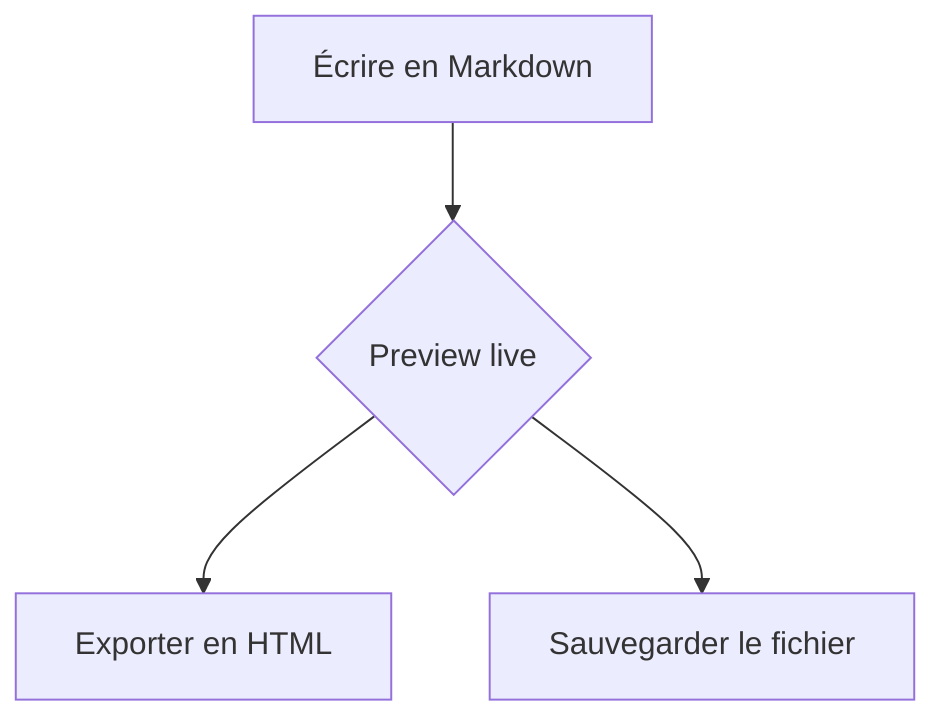

# Démo GMD

Ce document illustre les principales fonctionnalités de l'éditeur : mise en forme,
listes, tableaux, code, notes de bas de page et diagrammes.

## Mise en forme de base

Du **texte en gras**, de l'*italique*, du ~~texte barré~~, et du `code en ligne`.

Un [lien vers Seagle](https://seagle.io) et une citation :

> La simplicité est la sophistication suprême.

## Listes

- Premier élément
- Deuxième élément
  - Sous-élément
- Troisième élément

1. Étape une
2. Étape deux
3. Étape trois

## Tableau

| Fonctionnalité      | Statut |
| ------------------- | ------ |
| Preview live         | ✅     |
| Thèmes multiples     | ✅     |
| Sommaire             | ✅     |
| Mode wiki            | 🚧     |

## Bloc de code

```js
function bonjour(nom) {
  console.log(`Bonjour, ${nom} !`);
}

bonjour("GMD");
```

## Diagramme Mermaid



## Note de bas de page

Voici une affirmation qui mérite une précision[^1].

[^1]: Et voici la précision en question.

---

Fin de la démo.
